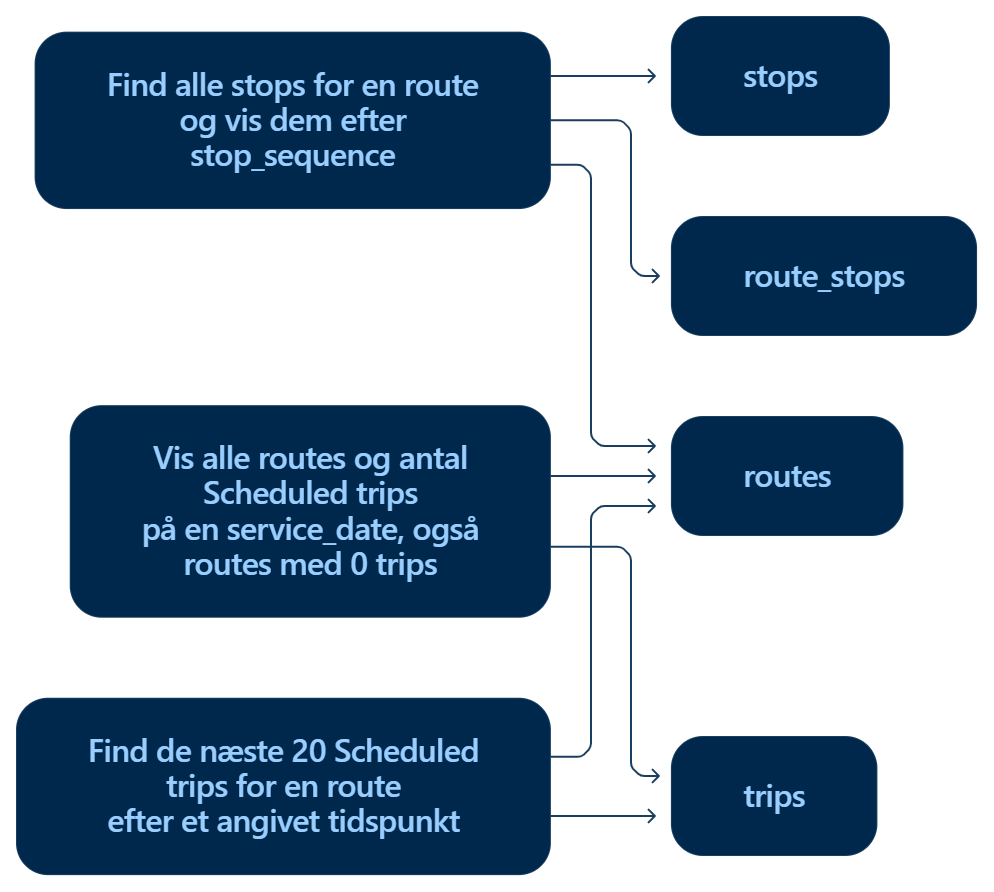
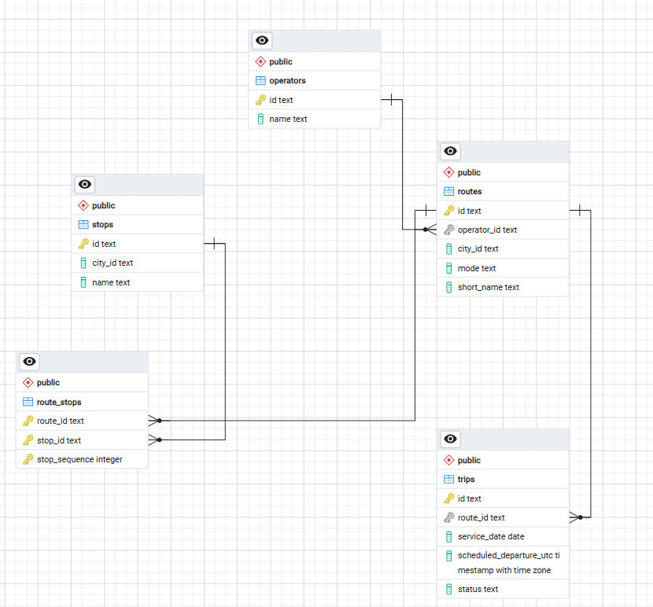

# Lecture 1 – Relational Slice

## Workload map



| Behov | Data/modeller der bruges |
|---|---|
| Find de næste 20 `Scheduled` trips for en `route` efter et angivet tidspunkt | `routes`, `trips` |
| Find alle `stops` for en bestemt `route` og vis dem i rækkefølge efter `stop_sequence` | `routes`, `route_stops`, `stops` |
| Vis alle `routes` og antal `Scheduled` trips på en bestemt `service_date`, også routes med 0 trips | `routes`, `trips` |


## Relational model



Modellen består af `operators`, `routes`, `stops`, `route_stops` og `trips`.

`route_stops` forbinder `routes` og `stops` og gemmer samtidig placeringen på ruten i `stop_sequence`.

`route_stops` bruger den sammensatte primary key:

`(route_id, stop_sequence)`

`route_id` er samtidig foreign key til `routes`, mens `stop_id` er foreign key til `stops`.

`trips` refererer til en `route` gennem `route_id`.

## ER model vs SQL schema

ER-modellen matcher de fem centrale relations i SQL-schemaet: `operators`,
`routes`, `stops`, `route_stops` og `trips`, inklusive deres primary- og
foreign-key-relationer. SQL-schemaet indeholder desuden den konkrete regel
`CHECK (stop_sequence > 0)`. Den type kolonneconstraint vises ikke
nødvendigvis i ER-diagrammet, men håndhæves af PostgreSQL.


## Modelling decision

En `route` må besøge det samme `stop` mere end én gang.

Derfor bruger `route_stops` den sammensatte primary key
`(route_id, stop_sequence)` i stedet for `(route_id, stop_id)`.

Det betyder, at en position på en route identificeres af routen
og dens rækkefølge. Samme `stop_id` kan derfor optræde flere gange
på den samme route.

Den relevante functional dependency er:

`(route_id, stop_sequence) -> stop_id`

```sql
create table route_stops (
    route_id text not null references routes(id),
    stop_id text not null references stops(id),
    stop_sequence integer not null,
    constraint route_stops_pk primary key (route_id, stop_sequence),
    constraint route_stops_sequence_positive check (stop_sequence > 0)
);
```

## Seed and query evidence

`002_seed.sql` indeholder routes, stops, ordered route stops og Scheduled trips.
`LINE-12` har bevidst ingen trips den 29. april 2026, så zero-count-adfærden
i den tredje workload-query kan observeres. De tre reproducerbare queries og
deres eksempelparametre findes i `database/postgres/init/003_queries.sql`.
